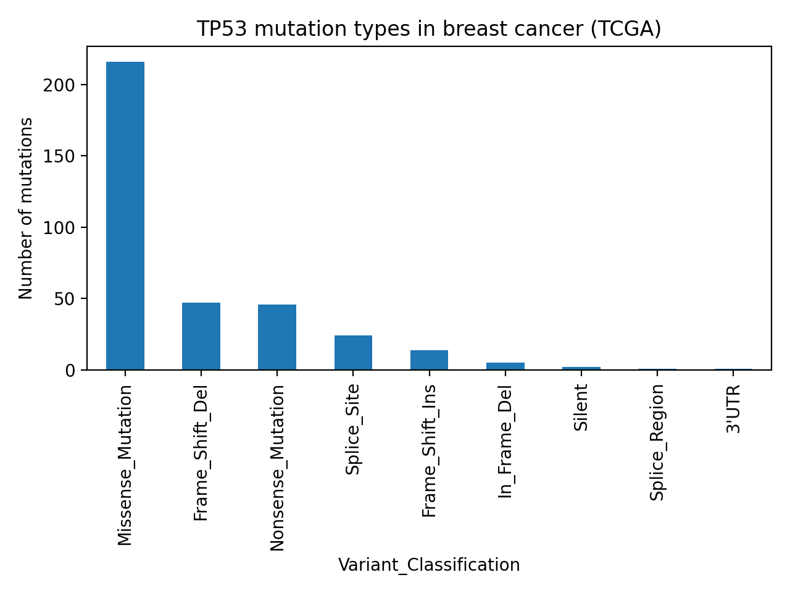
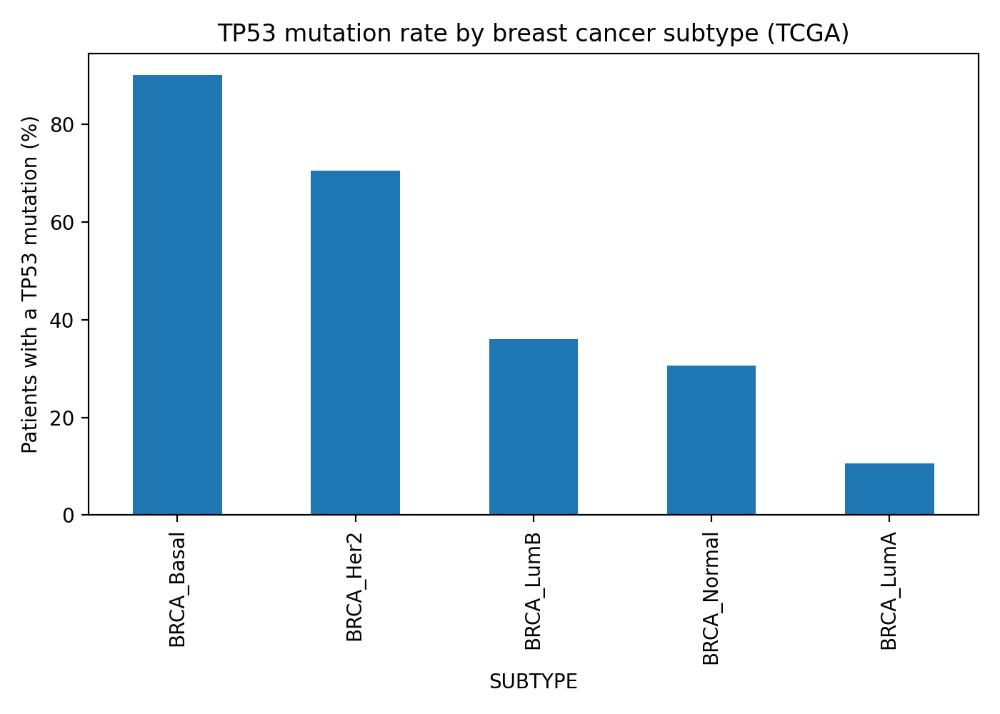
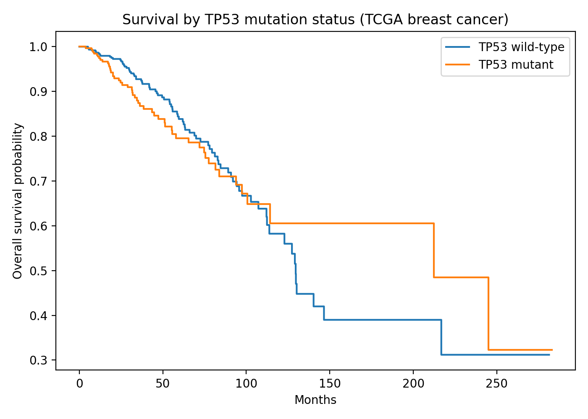
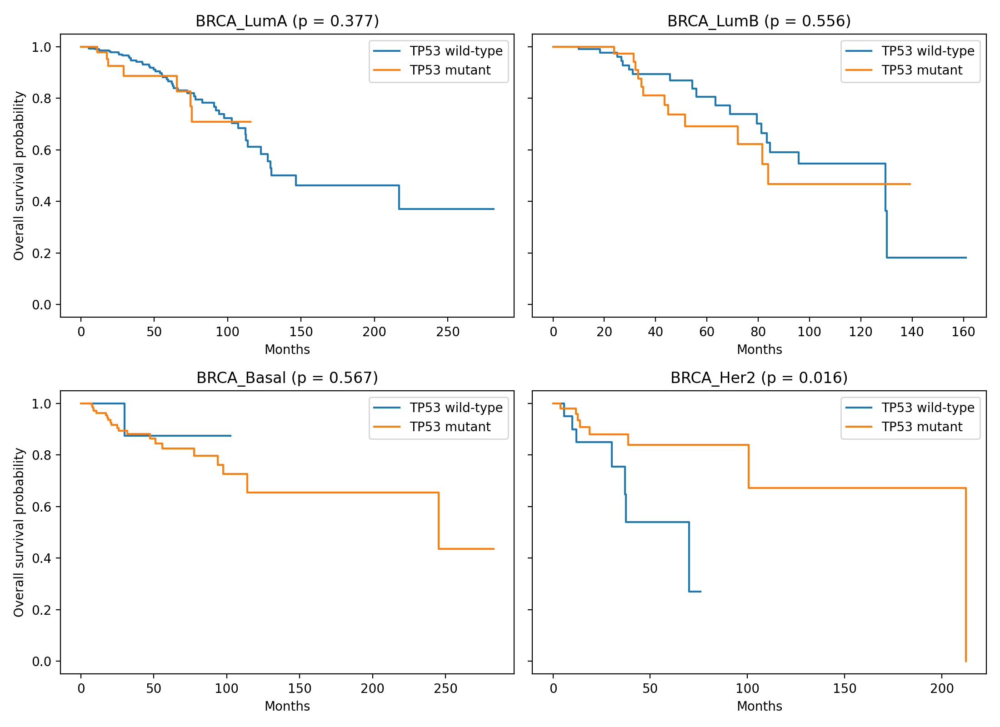

# TP53 mutations in breast cancer (TCGA)

An analysis of TP53 mutations, breast cancer subtype and overall survival in the TCGA breast cancer cohort, done in Python.

## Questions

1. Which TP53 mutations are most common in breast cancer?
2. Does the TP53 mutation rate differ between breast cancer subtypes?
3. Do patients with a TP53 mutation survive for a shorter time, overall and within each subtype?

## Data

Mutation and clinical files for Breast Invasive Carcinoma (TCGA, PanCancer Atlas) from cBioPortal. After matching the two files, 1,009 patients had both mutation and survival data. Of these, 981 have a subtype listed.

## Methods

- Filtered the mutation file to TP53 and counted mutation types and protein-level changes
- Calculated the share of patients with a TP53 mutation in each subtype
- Split patients into TP53-mutant (348) and wild-type (661), leaving out silent mutations
- Plotted Kaplan-Meier survival curves and compared them with log-rank tests, first for all patients and then within Luminal A, Luminal B, Basal-like and HER2-enriched subtypes

Tools: Python, pandas, matplotlib, lifelines, Google Colab

## Results

Mutations
- 348 of 1,009 patients (34.5%) carry a TP53 mutation
- Missense mutations are the most common type, 216 of 356 (about 61%)
- The most frequent hotspots are R175H (21 samples), R273H (13) and Y220C (7), all within the DNA-binding domain

Subtypes
- The TP53 mutation rate differs widely by subtype: Basal-like 90.1% (154 of 171), HER2-enriched 70.5% (55 of 78), Luminal B 36.0% (71 of 197), Normal-like 30.6% (11 of 36) and Luminal A 10.6% (53 of 499)

Survival
- Across all patients, survival did not differ significantly between mutant and wild-type groups (log-rank p = 0.48, 136 deaths). This comparison mixes subtypes: Luminal A makes up about 70% of wild-type patients with a subtype but only 15% of mutant patients
- Within subtypes there was no significant difference in Luminal A (p = 0.38), Luminal B (p = 0.56) or Basal-like (p = 0.57)
- In HER2-enriched tumors p = 0.016, with the mutant group doing better: 84% alive at 60 months against 54% in the wild-type group. This direction is unexpected given the common link between TP53 mutation and worse outcomes, and the result rests on 15 deaths, so it is treated as a possible small-sample effect

## Limitations

- Subtype is accounted for, but tumor stage and age are not
- Four subtype comparisons were run without correction for multiple testing. With a Bonferroni correction the cutoff would be 0.0125, so the HER2 result (p = 0.016) would not pass
- The HER2 comparison has 15 deaths and 23 wild-type patients. Basal-like has only 17 wild-type patients, so that comparison has little power. Normal-like was left out because it had too few patients
- The right-hand ends of the survival curves rest on very few patients. The HER2 mutant curve drops to zero near 210 months because the last patient still being followed died
- Only 136 patients died overall, and few were followed past 120 months, so the late part of the curves is noisy

## Files

- `TP53_mutation_analysis.ipynb`: mutation types and hotspots
- `TP53_survival_analysis.ipynb`: survival comparison of TP53-mutant and wild-type patients
- `TP53_subtype_analysis.ipynb`: mutation rate and survival by subtype
- `tp53_mutation_types.png`, `tp53_by_subtype.png`, `tp53_survival.png`, `tp53_survival_by_subtype.png`: figures
